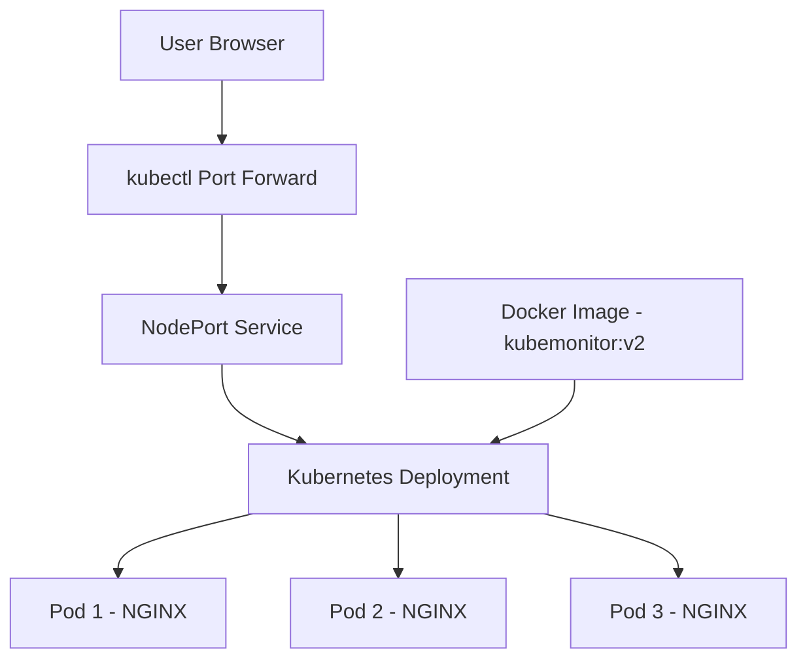

\# KubeMonitor – Kubernetes Deployment Project


\## Overview


KubeMonitor is a sample DevOps monitoring dashboard deployed locally using Docker and Kubernetes with Minikube.


This project demonstrates containerization, Kubernetes Deployments, Services, scaling, and rolling updates.


\## Technologies Used


\* HTML and CSS

\* Docker

\* Kubernetes

\* Minikube

\* kubectl

\* NGINX


\## Architecture


1\. The dashboard website is created using HTML and CSS.

2\. A Dockerfile packages the website into a container image.

3\. The image is loaded into the local Minikube cluster.

4\. A Kubernetes Deployment manages the application Pods.

5\. A NodePort Service exposes the application within the local Kubernetes environment.

6\. The Deployment is updated from v1 to v2 using a rolling update.

7\. The application is scaled to three replicas.


\## Project Features


\* Docker image creation

\* Kubernetes Deployment with multiple replicas

\* NodePort Service configuration

\* Application scaling

\* Rolling update from v1 to v2

\* Local deployment using Minikube


\## Run Locally


Start Minikube:


```bash

minikube start --driver=docker

```


Build the Docker image:


```bash

docker build -t kubemonitor:v1 .

```


Load the image into Minikube:


```bash

minikube image load kubemonitor:v1

```


Apply the Deployment:


```bash

kubectl apply -f deployment.yaml

```


Apply the Service:


```bash

kubectl apply -f service.yaml

```


Check the Pods and Service:


```bash

kubectl get pods

kubectl get svc kubemonitor

```


\## Rolling Update


Build and load the v2 image, then update the Deployment:


```bash

docker build -t kubemonitor:v2 .

minikube image load kubemonitor:v2

kubectl set image deployment/kubemonitor kubemonitor=kubemonitor:v2

kubectl rollout status deployment/kubemonitor

```


\## Scaling


```bash

kubectl scale deployment kubemonitor --replicas=3

kubectl get pods

```


\## Access the Dashboard


```bash

kubectl port-forward service/kubemonitor 8081:80

```


Open `http://localhost:8081` in your browser while port-forwarding is running.


\## Important Note


The dashboard's displayed monitoring values are sample/demo data. The HTML dashboard is not currently connected to live Kubernetes metrics.


\## Learning Outcomes


\* Containerizing a web application

\* Deploying applications on Kubernetes

\* Exposing applications through Services

\* Scaling Pods

\* Performing Kubernetes rolling updates

\* Managing a local Kubernetes development environment


## Architecture Diagram



### Architecture Explanation

1. **Docker:** Packages the website into a container image.
2. **Minikube:** Runs the local Kubernetes cluster.
3. **Deployment:** Maintains the desired number of application replicas.
4. **Pods:** Run the NGINX containers serving the dashboard.
5. **Service:** Provides network access to the application.
6. **Port Forward:** Lets us access the dashboard at `http://localhost:8081`.


